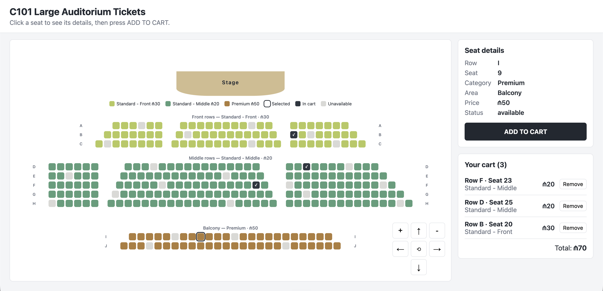

# Auditorium Tickets — Interactive Venue Ticketing System

A front-end ticket-selection website for an auditorium, built for the
Web & Mobile I course with plain **HTML, CSS and JavaScript** .

## Features
- Seat map with **316 seats** in 10 rows, generated from JavaScript data
- Three price categories:
  - **Standard - Front** (rows A–C) — ₼30
  - **Standard - Middle** (rows D–H) — ₼20
  - **Premium** (rows I–J, balcony at the top back) — ₼50
- Click a seat to **inspect** it (row, seat, category, price, status) — only
  **ADD TO CART** adds it
- Seat states: available, selected, in cart, unavailable
- Map controls: zoom in/out, move up/down/left/right, reset/center view
- Cart with ticket list, total price and remove buttons — always in sync with the map
- No duplicate tickets; unavailable seats and seats already in the cart cannot be selected
- Cart is saved in **localStorage** and restored after a page refresh
- Keyboard support: Tab through the seats, Enter to select, Escape to unselect
- Responsive layout for desktop, tablet and mobile

## How to run
No installation needed. Download or clone the repository and open `index.html`
in any modern browser.

## Project structure
| File | Purpose |
|---|---|
| `index.html` | Page structure (header, map, controls, seat details, cart) |
| `style.css` | All styles, including the responsive layout |
| `js/data.js` | Venue data: categories, rows, seat blocks and unavailable seats |
| `js/venue.js` | Generates the seat buttons and legend from the data; updates seat states |
| `js/navigation.js` | Zoom, move and reset/center of the map |
| `js/cart.js` | Cart logic, total price and localStorage |
| `js/main.js` | Starts the app and keeps the map, details panel and cart in sync |

## How the venue is generated
Each row in `js/data.js` lists its seat **blocks**, for example
`{ letter: "D", category: "middle", blocks: [6, 16, 11] }` — three blocks separated
by aisles. `buildSeats()` turns the rows into seat objects with ids such as `"D-12"`,
and `venue.js` creates one `<button>` per seat. Changing the data changes the map;
no seat is written by hand in the HTML.
